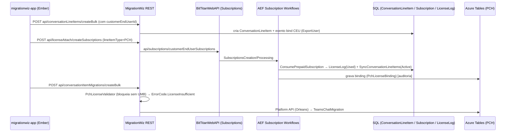

# Scaffold Arquitetural MigrationWiz + Feature 1 (PCH / UMB)

> [!info] Escopo e método
> - Varredura de **169 `.csproj`** em `C:\$\Development` (Master.sln) e do monorepo Ember em `C:\$\Front\FrontEnd`.
> - **Contagem de arquivos**: arquivos físicos no diretório do projeto, excluindo `bin/`, `obj/`, `node_modules/`, `packages/` e subpastas que têm outro `.csproj`. O primeiro número conta só `.cs`. O "+N" conta outros códigos (`.js/.ts/.cshtml/.aspx/.ascx/.asax/.ashx/.asmx/.svc/.master/.sql/.ps1/.psm1/.hbs`). No frontend contam-se `.js/.ts/.hbs/.less/.scss`, excluindo também `dist/`, `tmp/` e `bower_components/`.
> - Nenhum arquivo do repositório foi alterado, e nada foi adicionado ao Git.
> - Referências de linha (`arquivo:linha`) refletem o branch `develop` em 2026-11-02.

---

## 1. Tabela explicativa: projetos do ecossistema MigrationWiz

### 1.1 Camada Web / API (porta de entrada)

| Projeto / Módulo | O que Trata / Responsabilidade | Arquitetura & Padrões | Comunicação & Dependências | Arquivos Envolvidos |
|---|---|---|---|---|
| **MigrationWiz** | Site principal do MW e REST API `api/...` consumida pela SPA Ember. Controllers de Projects, ProjectItems, ConversationItems (PCH), LicenseAttach e Estimates. | ASP.NET MVC5 + Web API 2 + OWIN. Camada de Services (`Api\Services\I*Service`), DTOs/FindRequests, base `MigrationWizEntityController : EntityController`, filtros globais (Authorize, LogRestCallDuration). **Sem container de DI**: serviços criados em propriedades lazy e singletons (`LicenseManager.Instance`). | ORM in-process via MigrationCommon/WebApiCore; REST para BitTitanWebAPI (subscriptions); Platform API (Orleans) para PCH (`PlatformApiClient`); Azure Tables/Blobs (PCH); Mailer embutido via VirtualPathProvider. | **628** .cs (+38) |
| **MigrationWizWebApp** | UI legada (WebForms) e **hub SOAP** v1/v2 (`API/2.0/WebService.asmx`) usado por engine, PowerShell/SDK e parceiros. | WebForms (`BasePage/SecurePage`). Um único endpoint `Execute(Request)` em que cada `Request` se executa (**Command**). Contexto por SOAP Headers. | Chamado via MigrationProxy. Grava em SQL via MigrationCommon. Registra resolvers em `Startup.cs` (`LicenseManagerResolver`). | **74** .cs (+38) |
| **MigrationWebCommon** | Peças REST compartilhadas: Hybrid CSV import, serviço `ProjectSystemTypes`, DTOs. | Interface de serviço + implementação. | Usado por MigrationWiz e BitTitanWebAPI. | **15** .cs |
| **WebApiCore** | Framework REST comum (MW, BitTitanWebAPI, Internal): `EntityController`, FindRequests, middleware, Swagger, JWT/OpenID. | Base classes / Template Method, OWIN middleware. | Base de MigrationWiz, BitTitanWebAPI e BitTitanInternalWebApp. | **185** .cs |
| **BitTitanWebAPI** | API da plataforma BitTitan/MSPComplete (`api.bittitan.com`): **Subscriptions (UMB)**, CustomerEndUsers, ProxyJob, Runbooks. | REST gerado por **RestAPIGenerator** (Controllers/ModelMappers/Sideloaders `*.Generated.cs`) + partial classes manuais. Autofac via `VersionResolver` em partes; EF pontual. | In-process com MigrationCommon/MigrationWebCommon. Dispara workflows AEF (SubscriptionsCreation/Revoke). Serve SOAP de gestão (ManagementProxy). | **377** .cs (+48) |
| **BitTitanWebApiCommon** | DTOs, Messages, Requests e Responses da BitTitanWebAPI, compartilhados com clients e testes. | Contratos/DTO. | Referenciado por BitTitanWebAPI, testes e clients. | **678** .cs |
| **BitTitanInternalWebApp** | Portal interno (Support/Ops/Sales/Finance/Dev): **View/Edit Product SKU**, LicensingData import/export, entidades MW/SendBus, área AEF. | MVC5 + **Autofac** (composition root em `Global.asax.cs ConfigureDependencyInjection`), `IControllerService` por varredura de assembly. | MigrationCommon in-process, Migration/ManagementProxy, AEF via Service Bus. | **251** .cs (+340) |
| **PortalWebApp** | Portal white-label / private-label do MW (WebForms: ConnectorConfiguration, CouponPayment). **Não é o MSPComplete.** | WebForms. | MigrationCommon in-process. | **84** .cs (+42) |
| **Mailer** | Templates de e-mail (MvcMailer: `GenericMailer`, `CrmMailer`), views embutidas no MigrationWiz. | MVC views + Template. | Embedded resource → MigrationWiz. | **39** .cs (+36) |

### 1.2 Núcleo de domínio e plataforma

| Projeto / Módulo | O que Trata / Responsabilidade | Arquitetura & Padrões | Comunicação & Dependências | Arquivos Envolvidos |
|---|---|---|---|---|
| **MigrationCommon** | **Coração do domínio MW**: entidades ORM (`Migration\Core`: `MailboxConnector`=Projeto, `Mailbox`=Line item, `MailboxQueue`=execução, **`ConversationLineItem`=line item PCH**), mensagens SDK (`Sdk\Api\1.0\Messages\*Request`), conectores, clients, mappers, **LicenseManager**, Checkout, Reports, host WCF. | ORM próprio *database-first* por atributos (`[TableName]`, `[IdFieldName]`). **Strategy + Factory + Template Method** nos conectores (`MailboxConnectorSettings.Create` + `DescriptorsBuilder` lendo XML de descritores). Modelo de tarefas por atributo (`[ConnectorTask]`), **Observer** (`MailboxEventHandler : IEventHandler`), RuleManager, **Service Locator** Autofac (`Infrastructure\ServiceLocator`). | Referenciado por quase tudo. Hospeda WCF (`IMigrationService`). Azure Queues (SharePoint AMR). Agrega os módulos Clean Architecture. | **1738** .cs |
| **Common** | Plataforma compartilhada: ORM **SendBus** (code-first sobre LinqToSql: `Database\Objects`, `Access\Objects`), **Financial/Licensing** (`LicensingEngine`, `ProductSkuGuid`, `FeatureGuid`, `SubscriptionEntitlementManager`), Constants (`ProjectTypes`, `MailboxConnectorTypes`), FeatureFlags, EventHandler, MWActionLog, enfileiradores AEF. | ORM com hooks Pre/Post Create/Update/Delete; Observer; `VersionResolver` (módulo Autofac por versão de API); constantes/enums centralizados. | Referenciado por todos; SQL via ORM; Service Bus via CloudInfrastructure. | **1437** .cs (+5) |
| **Core** | Utilitários base sem dependências: `ResilientExecution` (Polly), Sql, Log, Threads, Serialization, `ErrorCode`. | Factory/Repository de políticas Polly (`ResilientPoliciesFactory`). | Base de toda a solution. | **210** .cs |
| **MigrationUniversal** | Modelo canônico "Universal" de itens (Core/Convert/Reader/Serialize). Origem e destino traduzem por ele. | Modelo pivô (Adapter/Canonical Data Model). | Só depende de Core/BTLog; usado por conectores e mappers. | **221** .cs |
| **EmailClientCommon** | **Client SPI** genérico `IMigrationWizClient<TContainer,TItem>` com paginação; clients Exchange/Internet/WorkMail; **`MigrationWizToMspcSyncingService`** (sincroniza Mailbox↔CustomerEndUser/UMB). | Plugin/SPI (doc `Platform/clientSPI.md`). | Usado pelos conectores (MigrationCommon) e pelo fluxo de subscriptions. | **131** .cs |
| **SharePointCommon** | Acesso SharePoint/OneDrive (CSOM, Graph, MSAL). | Classes estáticas `Commands\*Command`, Services, Context. | Conectores de Document/OneDrive; SharePointPowerShell. | **133** .cs |
| **PowerShellExtension** | Hospeda sessões PowerShell Exchange Online / AzureAD / Graph (`ExchangePowerShell`, `JobExecutor`). | Template (`PowerShellBase`). | Conectores e AEF. | **89** .cs (+5) |
| **OemCommon** | Plataforma OEM/parceiros (invoices, consumo). | Serviços de integração. | MigrationCommon. | **121** .cs |
| **Estimator** | Estimativa de esforço/preço por workload. | **Strategy** (`IEstimator`, `MailWorkload`, `DocumentWorkload`…). | BitTitanWebAPI. | **13** .cs |
| **Caching** | Cache local LRU + Redis distribuído (`RedisCacheService`, `FastDistributedLock`). | **Decorator/Interceptor** Castle (`ResilientExecutionInterceptor`, `FeatureToggleInterceptor`). | Usado por serviços web e engine. | **25** .cs |
| **BTLog / BTTelemetry** | Logging Serilog (Elasticsearch/Kibana, Seq) e Application Insights. | Configuração de sinks e enrichers. | Transversal (Kibana é exigido pelo PRD). | **24** (+1) / **3** .cs |
| **ExchangeOnline.Mailbox / ZimbraLib / MigrationClients.Google** | Clients específicos (EXO helper, Zimbra SOAP, Google OAuth). | Client wrappers. | Conectores em MigrationCommon. | **3** / **105** / **2** .cs |

### 1.3 Engine de migração (workers)

| Projeto / Módulo | O que Trata / Responsabilidade | Arquitetura & Padrões | Comunicação & Dependências | Arquivos Envolvidos |
|---|---|---|---|---|
| **MigrationWizEngine\MigrationService** | Windows Service/console que hospeda `MigrationServiceInstance` nos workers. | `ServiceBase` host. | Usa MigrationCommonClient, ContainerService, TextExtractor. | **5** .cs |
| **MigrationWizEngine\MigrationCommonClient** | Runtime do engine: Scheduler, Downloader, Processor, StatusUploader, Pinger, Registrator, `MigrationZoneSchedulerAzureVmss`, Watermark, Storage. | Workers por timer (`ThreadedTimerBase`), Factory (`MailboxMigrationExecutorFactory`), **Strategy** de storage, **Proxy** SOAP genérico (`MigrationSoapClientProxy`). | **Pull via SOAP** (MigrationProxy → MigrationWizWebApp) sobre `MailboxQueue`. **Não há barramento** entre web e engine; a ponte é SQL + polling SOAP. | **67** .cs |
| **MigrationWizEngine\Microservices\TeamsChatMigrationService** | Microserviço Docker/K8s que importa **chats do Teams (PCH)** no destino via Graph. | Service layer com interfaces (`IMigrationWizTeamsService`), DI manual com `Lazy<>`, graceful cancellation. | Lê **Azure Storage Queue** (`ChatQueueStorageService`) e Blobs criptografados; busca Mailbox/Connector via SOAP; posta no Graph. *Fora do escopo da Feature 1 (PRD 5.2.2: sem mudanças no engine PCH).* | **11** .cs (+2) |
| **MigrationWizEngine\MigrationServiceUtilities** | Toolbox dev/ops: utilitários por conector, `UmbUtilities` (atribuir UMB a CEU/mailbox), `AzureTableItemsProvider`. | Factories (incluindo mocks). | Referencia quase todo o engine; Azure Queues/Tables. | **84** .cs |
| **MigrationWizEngine\Clients\*** (LotusExtractor, GoogleVaultExport, HybridAgent, HybridAgentLib) | Agentes no lado do cliente (Lotus, Vault, Hybrid). | Polling de comandos via WCF (`GetNextCommand`). | WCFProxy, MigrationProxy, ClientLogUploader. | **56** / **11** / **15** (+1) / **31** .cs |
| **MigrationWizEngine\ExtractorCommon / ExtractorContract** | Base dos extractors (`MigrationThreadCoordinator`, `NativeProcessManager`) e seus contratos/erros. | Coordinator, contratos. | WCF/SOAP. | **16** / **7** .cs |
| **MigrationWizEngine\ClientLogger** | Upload de logs dos agentes. | **Strategy + Factory** (`AzureBlob` / `S3ClientLogUploader`). | Azure Blob / S3. | **8** .cs |
| **MigrationWizEngine\SharePointPowerShell** | Módulo PowerShell para tarefas SharePoint. | Cmdlets C#. | SharePointCommon. | **16** .cs (+11) |
| **MigrationWizEngine\AutoUpdate / GroupWise7Proxy / GroupWise8Proxy** | Auto-update dos workers; web references SOAP GroupWise. | Proxy gerado. | MigrationService/conectores. | **2** / **2** / **2** .cs |
| **MigrationProxy / ManagementProxy / WCFProxy** | Clients SOAP gerados (ASMX) para MW e para a gestão BitTitan; proxy WCF. | **Proxy** gerado + `SafeExecution`. | Canal SOAP do engine, SDK PowerShell, extractors e microserviço Teams. | **7** / **7** / **2** .cs |
| **ContainerService / CloudInfrastructure / AzureCommon** | Docker/Swarm dos workers; Azure Service Bus (REST), AKS, KeyVault; resolução de nuvem (incluindo **Germany**). | Factory, Strategy (`ICertificateService`). | Engine, AEF. | **20** / **29** / **3** .cs |

### 1.4 Módulos Clean Architecture (workloads novos)

| Projeto / Módulo | O que Trata / Responsabilidade | Arquitetura & Padrões | Comunicação & Dependências | Arquivos Envolvidos |
|---|---|---|---|---|
| **GoogleSharedDrive** (Application / Domain / Infrastructure / ExportConsumer / testes) | Migração de Google Shared Drives. | **Clean Architecture**: Domain anêmico (`AggregatesModel`), Application services + AutoMapper, Infrastructure com **Decorators** (retry, cache, exception), Polly, Redis. DI com **Autofac Module** + interceptors Castle (NullChecking). Sem MediatR/CQRS. | In-process: conectores do MigrationCommon resolvem via `ServiceLocator` (`*AppModuleBuilder`). | **94** / **21** / **100** / **8** / testes 13+37 .cs |
| **GoogleGroups** (Application / Domain / Infrastructure / Consumer / testes) | Migração de Google Groups. | Idem acima. | Idem. | **26** / **8** / **28** / **5** / testes 6+13 .cs |
| **GoogleVault** (Application / Domain / Infrastructure / ExtractConsumer / testes) | Extração Google Vault. | Idem (`GoogleVaultOrchestratorService`). | Idem + UploaderWiz. | **17** / **4** / **30** / **5** / testes 6 .cs |
| **M365Groups** (Application / Domain / Infrastructure / Consumer / testes) | Migração de Microsoft 365 Groups. | Idem (`GraphApiM365GroupsService`, `M365GroupsClientRetryDecorator`). | Idem; Graph. | **16** / **8** / **22** / **5** / testes 6+2 .cs |
| **M365SharedMailbox** (Application / Domain / Infrastructure / Consumer / testes) | Shared Mailboxes M365 (permissões). | Idem (`SharedMailboxService`, `PermissionService`). | Idem; EXO PowerShell. | **18** / **6** / **9** / **5** / testes 5+1 .cs |

### 1.5 Orquestração assíncrona, SDK e geradores

| Projeto / Módulo | O que Trata / Responsabilidade | Arquitetura & Padrões | Comunicação & Dependências | Arquivos Envolvidos |
|---|---|---|---|---|
| **AsyncExecutionFramework\AEFCommon / AEFCoordinationService / AEFExecutionService** | Runtime de workflows assíncronos (Dispatcher, WorkflowFactory/ActivityFactory, PushScheduler, TimerWheel) e os serviços Windows de coordenação e execução. | Orquestração **Workflow/Activity (Pipeline)**, Factory, plugins por reflection. | **Azure Service Bus** (CloudInfrastructure) + SendBus DB. | **37** / **6** / **5** .cs |
| **AsyncExecutionFramework\AEFWorkflows** | Workflows MW: **Subscription** (Creation/Processing/Revoke/ExpiredProcessing), `MailboxToCustomerEndUserActivity`, AssignM365License, Discovery, T2T. | Workflow/Activity. | Service Bus; chama mensagens SDK (`ConsumePrepaidSubscriptionRequest`). | **254** .cs (+6) |
| **AsyncExecutionFramework\AEFInternalAutomationWorkflows / AEFAutomationWorkflows** | Automação interna: **AuditLicenseLog**, **AuditSubscriptionAbuse** (Sales), finanças. | Workflow/Activity. | Service Bus, SendBus DB. | **139** (+3) / **43** .cs |
| **BitTitanPowerShell (SDK)** | Módulo PowerShell público. Cmdlets `MW_*` / `BT_*` gerados (SDK usado no bulk edit de endereços). | Código gerado (`Cmdlets.Generated.cs`) + cmdlets manuais. | SOAP via MigrationProxy/ManagementProxy. | **45** .cs (+35) |
| **MigrationSupportPowerShell** | Cmdlets de suporte MW. | Cmdlets. | MigrationProxy. | **7** .cs |
| **ORMGenerator / RestAPIGenerator / CodeGenerator** | Gera entidades ORM (YAML → Common); camada REST da BitTitanWebAPI (XML → Controller/DTO/Service); cmdlets PowerShell. | Geradores de código (build-time). | Saída versionada em Common / BitTitanWebAPI / BitTitanPowerShell. | **23** / **24** / **30** .cs |
| **Databases\MigrationWiz (SSDT)** | Schema SQL do MW (`Tables\Mailboxes.sql`, `MailboxConnectors.sql`, **`ConversationLineItem.sql`** …). | Database project (fonte do schema *database-first*). | Base do ORM MigrationCommon. | `.sqlproj` (fora da contagem `.csproj`) |
| **Deployment\{Prod,Germany}\LicensingData.xml** | Catálogo de **Features / ProductSkus / ProductSkuFeatures / ProductRates** (carregado por `DatabaseBootstrapService.CreateLicensingData`). | Dados de configuração. | `LicensingEngine.ImportLicensingData`; editável também via Internal WebApp. | 2 XML (Prod com ~9.831 linhas) |
| **Coexistence / UploadWiz / DnsCommon** | Free/Busy O365↔Google; uploader desktop (PST/File Server); DNS. Adjacentes ao MW. | Web API; Pipeline Explorer→Dispatcher→Executor; utilitários. | MigrationService; MigrationCommon. | **20** (+1) / **61** / **47** .cs |

### 1.6 Testes do ecossistema MW

| Projeto / Módulo | O que Trata / Responsabilidade | Arquitetura & Padrões | Comunicação & Dependências | Arquivos Envolvidos |
|---|---|---|---|---|
| **UnitTestMigrationWiz** | Testes unitários do MW (serviços API, controllers, ORM validator, LicenseLog). | NUnit + MSTest + Moq. | MigrationWiz, MigrationCommon. | **562** .cs |
| **UnitTestCommonComponents** | Testes de Common (Licensing, Subscriptions, Bootstrap, DomainReplacement). | NUnit + Moq. | Common. | **475** .cs |
| **IntegrationTestMigrationWiz / IntegrationTests** | Integração de conectores e engine; LicenseManager, Revoke/ConsumePrepaidSubscription. | Testes ReadOnly/ReadWrite. | DB/serviços reais. | **40** / **431** .cs |
| **ApiTests** | Testes REST (incluindo `LicenseAttachTest`, `SubscriptionsControllerTest`, `MigrationEstimatesPostTest`). | Testes de API. | MigrationWiz / BitTitanWebAPI. | **258** .cs |
| **AEFUnitTests / AEFIntegrationTests** | Testes de workflows (incluindo `SubscriptionsRevokeActivityTests`). | — | AEF. | **102** / **85** (+1) .cs |
| **AutomatedUITests\MigrationWizUITests** | UI tests Ranorex (`ApplyAUserMigrationBundle`, `ChangeDomainAddress`). | Ranorex. | UI MW. | **54** .cs (+4) |
| **TestCommon** | Helpers (`TestHelper`: mailbox, subscription, CollaborationChat). | — | Todos os testes. | **47** .cs |

### 1.7 Frontend (fora da Master.sln, mas parte do MW)

| Projeto / Módulo | O que Trata / Responsabilidade | Arquitetura & Padrões | Comunicação & Dependências | Arquivos Envolvidos |
|---|---|---|---|---|
| **Front\FrontEnd\migrationwiz-app** | SPA do MigrationWiz (toolbar do projeto, grid, flyouts Add from MSPC / Apply UMB / Change Domain, Start Migration). | **Ember.js** (models, adapters, serializers, components, services, `ember-concurrency` tasks); toolbar legada em `-project-items-old.hbs`. | REST `api/...` do MigrationWiz + `api.bittitan.com` (BitTitanWebAPI). Build injetado em `MigrationWiz\Static\migrationwiz-app`. | **1058** (791 js, 241 hbs, 26 less) |
| **Front\FrontEnd\mspcomplete-app** | SPA do MSPComplete (People, Settings > Licenses). | Ember. | BitTitanWebAPI. | **1599** |
| **Front\FrontEnd\store-app** | Loja BitTitan (store.bittitan.com): card do produto **700002 (UMB)**, descrição e cenários. | Ember. | BitTitanWebAPI / shopping-cart. | **232** |
| **bittitan-ember-lib / bittitan-i18n** | Models compartilhados (`project-type`, `project-system-type`, `mspc/customer-end-user`) e traduções (`en-PT` = inglês de dev). | Addon Ember / i18n. | Usado pelas apps. | — |

> [!note] Fora do ecossistema MW (contabilizados, mas não mapeados acima)
> Nautilus\* (harness de benchmark), DeviceManagementServices\*, AutomationScriptRunner\*, DnsWonder, Zendesk, InternalAutomationTools\*, DevMetrics, LogViewer, CmdletDocumentation\* e outros utilitários de build/tooling. A lista completa das contagens dos 169 projetos foi gerada durante a análise.

---

## 2. Resumo: o que é o MigrationWiz e como está estruturado

**O que é.** O MigrationWiz (BitTitan / Idera) é uma plataforma SaaS de migração de dados para a nuvem. Ela move mailboxes, documentos (OneDrive/SharePoint/Google Drive), arquivos PST, Teams (canais = *Teamwork*; chats privados = *Collaboration Chat / PCH*), Google Groups/Shared Drives/Vault, M365 Groups e Shared Mailboxes entre tenants e plataformas. É comercializado por licenças: *per-item* e o **User Migration Bundle (UMB, SKU 700002)**, que é por usuário e vale 12 meses. As licenças são gerenciadas no **MSPComplete** e vendidas na **BitTitan Store**.

**Como está estruturado.**
- É um **monólito em camadas, .NET Framework 4.8**, com csproj no formato antigo, dependências via **paket** e build pelo `Master.sln` no Azure Pipelines.
- **Web:** `MigrationWiz` serve REST + SPA Ember e `MigrationWizWebApp` serve WebForms + hub **SOAP** `Execute(Request)`.
- **Domínio:** `MigrationCommon` contém o domínio MW e um ORM próprio *database-first* (schema SSDT em `Databases\MigrationWiz`). Fica sobre `Common`, que tem o ORM SendBus, Licensing/Financial e as constantes, e sobre `Core`.
- **Entidades centrais:** `MailboxConnector` é o Projeto, `Mailbox` é o Line item clássico, `MailboxQueue`/`MailboxMigration` é a execução e **`ConversationLineItem` é o Line item PCH**.
- **Engine:** worker *pull-based* (`MigrationService`/`MigrationCommonClient`) que faz polling SOAP. PCH é diferente: roda via **Platform API (Orleans)** + **Azure Storage Tables/Queues** + microserviço `TeamsChatMigrationService`.
- **Conectores:** Strategy/Factory/Template Method (`MailboxConnectorSettings` + XML de descritores). Os clients implementam a SPI `IMigrationWizClient`, e os itens passam pelo modelo pivô `MigrationUniversal`.
- **Workloads novos:** módulos *Clean Architecture* isolados (Domain/Application/Infrastructure, Autofac, Decorators, interceptors Castle, AutoMapper, Polly), acessados por um `ServiceLocator` estático.
- **Assíncrono:** o AEF, sobre Azure Service Bus, orquestra subscriptions/UMB, auditoria e sincronização com o MSPComplete.
- **Licenciamento UMB:** `Subscription` (ProductSku UMB) amarrada a um **CustomerEndUser (CEU)**. O line item guarda `CustomerEndUserId` + `SyncSubscriptionStatus`. A elegibilidade vem de `RequiredFeatures` do descritor × `ProductSkuFeature` (LicensingData.xml) × `SubscriptionEntitlementManager`.

**Não existem** MediatR, CQRS, EF Core nem Repository/UoW genéricos. Não proponha esses padrões: siga o estilo existente.

---

## 3. Dicas para o Claude Code trabalhar melhor neste repositório

1. **Crie um `CLAUDE.md`** na raiz de `Development` (não há um hoje) com: .NET 4.8 + paket, "sem DI container no MigrationWiz", os dois ORMs, as entidades centrais e a regra de que PCH usa `ConversationLineItem`, não `Mailbox`. Aponte para `Documentation\Page\*` (Orm, OrmGenerator, clientSPI, AEF).
2. **Sempre procure o "irmão" Mailbox/OneDrive antes de criar algo.** Os tickets pedem explicitamente reuso. Padrão de busca: `grep` pelo nome Mailbox (`ProjectItem*`, `MailboxSummary`, `SyncMailboxes`) e depois pelo equivalente PCH (`ConversationLineItem*`, `ConversationItem*`, `isTeamsPCH`, `CollaborationChat`).
3. **Não edite arquivos `*.Generated.cs`** (BitTitanWebAPI, BitTitanPowerShell). Altere a fonte (XML/YAML do gerador) ou a *partial class* manual.
4. **Toda coluna nova em entidade MW passa por 5 camadas:** `Databases\...\Tables\*.sql`, `MigrationCommon\Migration\Core\*.cs`, `MigrationCommon\Sdk\Api\1.0\Objects\*.cs`, `Common\Access\Objects\MigrationWiz\*.cs` e `MigrationWiz\Api\DTOs\*DTO.cs`. Peça ao Claude um checklist por camada.
5. **Trabalhe por projeto, não pela solution inteira.** O `Master.sln` tem 169 projetos. Use subagentes Explore com escopo de pasta e prefira `msbuild <projeto>.csproj` a buildar tudo.
6. **No frontend**, as strings de dev ficam em `bittitan-i18n\translations\*\en-PT` (o `en` sobrescreve só alguns valores). Outras línguas vêm do CrowdIn, então não as edite.
7. **Feature flags:** use `Common\FeatureFlags\FeatureToggleNames.cs` para *gating* (o PRD diz que só projetos PCH **novos** terão enforcement). Isso evita quebrar projetos existentes.
8. **Logs para Kibana:** use BTLog/Serilog estruturado e `MWActionLogService`. O PRD exige rastrear o motivo de bloqueio e as métricas de consumo.
9. **PRD 7.10:** todo output de IA precisa de revisão humana, e não se deve enviar segredos ou PII ao modelo. Não cole `Web.config`/`app.config` com connection strings nos prompts.

---

## 4. SCAFFOLD DA FEATURE 1: UMB License Enablement para Teams Private Chat

> [!abstract] Tickets cobertos
> **MW-12732** (Épico/backend core) · **MW-12746** (Apply/Remove License) · **MW-12745** (Add from MSPComplete) · **MW-12747** (Store/Marketing) · **MW-12099** (SKU interno / LicensingData.xml).
> *Dependência de sequenciamento (PRD 4.5):* Change Domain e SDK bulk são da **Feature 2** (MW-12737/12738), mas o MW-12732 exige que a binding sobreviva a essas mudanças. Por isso o scaffold os inclui como "pontos de contrato".

### 4.0 Diagnóstico: o estado atual do código

| Ponto | Evidência | Impacto |
|---|---|---|
| Feature de licença PCH **não existe** no catálogo | `FeatureGuid.CollaborationChat` = `80941263-ca81-4f81-ac4b-823072378d6b` (`Common\Financial\Licensing\FeatureGuid.cs:129`) aparece em `CollaborationChatDescriptors.xml`, mas **0 ocorrências** em `Deployment\Prod|Germany\LicensingData.xml` | Nenhum SKU é elegível para PCH, e `GetEligibleProductSkuIds` retorna vazio |
| Estimativa PCH zerada | `ConversationItemMigrationsService.cs:306/314/328`: `TotalLicensesAvailable = 0`, `RequiredLicenseCount(0,0)`; chamadas reais comentadas | UI nunca acusa falta de licença |
| Submissão PCH sem checagem | `ConversationItemMigrationsService.CreateBulk` (:107-187) chama `PlatformApiClient` direto | Não há bloqueio de Verify/Pre-Stage/Full |
| Line item PCH sem binding CEU | `Databases\MigrationWiz\Tables\ConversationLineItem.sql` sem `CustomerEndUserId`/`SyncSubscriptionStatus`. `Common\Access\Objects\MigrationWiz\ConversationLineItem.cs:41` já declara `CustomerEndUserId` | Não há onde guardar a binding nem o status "UMB Active" |
| Apply/Revoke só para Mailbox | `LicenseAttachService.GetCustomerEndUserIdsFromProjectItemFindRequest` (:326-336) lê só `MailboxSummary` | Endpoints `api/licenseAttach/*` ignoram PCH |
| Regra 24h não implementada | `RevokeSubscriptionRequest.cs:30` `HOURS_AFTER_SUBSCRIPTION_CREATION_TRESHOLD = 48` declarado e **não usado** | Regra de revogação em 24h precisa de lógica nova |
| UI desliga PCH explicitamente | `project.js:917` (`!isTeamsPCH` em `supportsAddFromMspc`), `controllers\project\project-items.js:21-34` (`shouldHideApplyLicenses`), `-project-items-old.hbs:226-248` (`not isCollaborationChat`), `start-migration.js:900` (`_canUseUmb`) | Toolbar sem Apply/Remove/Add from MSPC |

### 4.1 Fluxo alvo (resumo)

### 4.2 NOVOS arquivos a criar

> Convenção: siga os nomes e pastas dos equivalentes Mailbox. **Não** há MediatR/CQRS. A lógica fica em *Services* (MigrationWiz), *Requests* SDK (MigrationCommon) e *Activities* AEF.

| # | Novo arquivo (proposto) | Projeto / Pasta | Papel | Ticket | Espelha |
|---|---|---|---|---|---|
| N1 | `PchLicenseValidator.cs` (+ `IPchLicenseValidator.cs`) | `MigrationWiz\Api\Services\Licensing\` | Valida UMB ativo por `ConversationLineItem` antes de Verify/Pre-Stage/Full; devolve itens bloqueados + motivo | MW-12732 | `MailboxMigration.cs:796-854` + `LicenseManager.GetMailboxesExemptFromLicensing` |
| N2 | `ConversationItemSubscriptionRequest.cs` | `MigrationWiz\Api\Requests\` | Request de Apply/Revoke/Count baseado em `ConversationItemFindRequest` | MW-12746 | `ProjectItemSubscriptionRequest` |
| N3 | `ConversationLineItemEventHandler.cs` | `MigrationCommon\Sdk\Api\1.0\Events\` | Ao criar/atualizar `ConversationLineItem`, resolve/vincula o CEU pelo `ExportUser` (endereço de origem) e preserva a binding se o prefixo UPN não mudar | MW-12732 / 12745 | `MailboxEventHandler.cs:41-108` |
| N4 | `PchLicenseBindingTableEntity.cs` | `MigrationWiz\Api\Azure\Storage\` | Registro de auditoria da binding (PK=ConnectorId, RK=LineItemId; CEU, SubscriptionId, SourceUpn, AppliedAt, FirstJobSubmittedAt, Action) | MW-12732 | `ConversationLineItemTableEntity`, `LineItemQueueTableEntity` |
| N5 | `PchLicenseBindingStorageService.cs` (+ interface) | `MigrationWiz\Api\Services\` | Leitura/escrita da tabela N4 com `AzureCredentialsResolverService` por zona | MW-12732 | `ConversationLineItemsService.GetAzureTableStorageClient` (:894) |
| N6 | `ConversationLineItemToCustomerEndUserActivity.cs` | `AsyncExecutionFramework\AEFWorkflows\Synchronization\Activity\` | Catch-up assíncrono de binding CEU, incluindo o **provisionamento retroativo** de UMBs já aplicadas (PRD 4.5) | MW-12732 | `MailboxToCustomerEndUserActivity.cs` |
| N7 | Script de migração SQL (`ALTER TABLE ConversationLineItem ADD CustomerEndUserId, SyncSubscriptionStatus, MspcSynchronizationDate`) | `Databases\MigrationWiz\` (Tables + script de deploy/PostDeployment conforme o padrão do sqlproj) | Persistência da binding/estado | MW-12732 | colunas de `Mailboxes.sql` |
| N8 | Novos valores em `MWActionLogEventType` (`UmbLicenseApplied`, `UmbLicenseRevoked`, `MigrationBlockedNoLicense`) | `Common\MWActionLog\` | Auditoria/Kibana | MW-12732 / 12746 | `LogActionForMigrationStarted` |
| N9 | Testes: `PchLicenseValidatorTests.cs`, `ConversationItemMigrationsServiceTests.cs`, `LicenseAttachServiceTests.cs`, `RevokeSubscriptionRequestTests.cs`, `ConversationLineItemEventHandlerTests.cs` | `UnitTestMigrationWiz\MigrationWiz\Api\Services\` e `UnitTestMigrationWiz\Migration\Sdk\` | Cobertura positiva e negativa (sem licença, 24h, job já submetido, retry sem consumo extra, múltiplos projetos mesmo CEU) | todos | inexistentes hoje |
| N10 | Testes de API: `ConversationLicenseAttachTest.cs`, `PchMigrationEstimatesTest.cs` | `ApiTests\RestApi\MigrationWiz\` | E2E REST | MW-12746 | `LicenseAttachTest.cs` |
| N11 | Frontend: `app\validators\conversation-line-item.js` (ou variante PCH do `ProjectItemValidator`) | `migrationwiz-app\app\` | Validação do Add from MSPC para PCH | MW-12745 | `add-items-mspc.js:21-51` |
| N12 | Frontend: testes `tests\unit\controllers\project\project-items-test.js`, `tests\integration\components\modals\change-domains-test.js` | `migrationwiz-app\tests\` | Hoje não existem | MW-12746 | — |
| N13 | Store: `<li>` + tooltip "Teams Private Chat" e aba "TEAMS PRIVATE CHAT" | `store-app\app\templates\components\index\product-card-700002.hbs`, `...\index\product-description\user-migration-bundle.hbs` | Workload visível na loja | MW-12747 | itens Mailbox/Documents existentes |

### 4.3 Arquivos EXISTENTES a alterar (backend)

| Projeto | Arquivo | Alteração | Ticket |
|---|---|---|---|
| **Deployment** | `Deployment\Prod\LicensingData.xml` **e** `Deployment\Germany\LicensingData.xml` (master **e** develop) | Adicionar `<Feature>` CollaborationChat `80941263-…` em `<Features>`. Adicionar `<ProductSkuFeature>` ligando o UMB `39854d8c-…` (700002) **e** as variantes Incentive/BF/EDU à feature (modelo: Teamwork `a4025dd9` em :262/:5769/:6414). | MW-12099 / 12732 |
| **Common** | `Financial\Subscriptions\SubscriptionEntitlementManager.cs:18` | Garantir que o SKU que cobre PCH está em `ProductSkuIncludedEndUserPremiumSubscriptionHashSet` | MW-12732 |
| **Common** | `Financial\Licensing\FeatureGuid.cs` / `ProductSkuUtils.cs` | Só se for preciso helper (`IsPchEligible`); o GUID já existe | MW-12732 |
| **Common** | `Access\Objects\MigrationWiz\ConversationLineItem.cs` | Adicionar `SyncSubscriptionStatus`, `MspcSynchronizationDate` (o `CustomerEndUserId` já existe) | MW-12732 |
| **Common** | `FeatureFlags\FeatureToggleNames.cs` | Flag `pch-umb-licensing` (enforcement só para projetos novos: PRD 4.5) | MW-12732 |
| **Common** | `MWActionLog\*` | Novos event types (N8) | MW-12732 |
| **MigrationCommon** | `Migration\Core\ConversationLineItem.cs` | Novas colunas e atributo `[EventHandler(typeof(ConversationLineItemEventHandler))]` | MW-12732 |
| **MigrationCommon** | `Sdk\Api\1.0\Objects\ConversationLineItem.cs` | Expor `CustomerEndUserId` e `SyncSubscriptionStatus` no SDK (bulk via PowerShell) | MW-12732 |
| **MigrationCommon** | `Migration\Core\LicenseManager.cs` (:339, :360, :732, :739) | Incluir `ConversationLineItem` no cálculo de isenção/elegibilidade; avaliar o atalho "UMB-only" para CollaborationChat (como T2T em :739) | MW-12732 |
| **MigrationCommon** | `Sdk\Api\1.0\Messages\ConsumePrepaidSubscriptionRequest.cs` (:187, :249, :316, :377) | Após consumo, sincronizar também os `ConversationLineItem` do CEU. **Manter** `FilterAndFixAlreadyProcessedSubscriptions`/`DeleteInvalidSubscriptions` (1 UMB por CEU, ref. MW-12052/MW-11977) | MW-12732 |
| **MigrationCommon** | `Sdk\Api\1.0\Messages\RevokeSubscriptionRequest.cs` (:30, :90, :270) | Implementar a janela de **24h** (hoje a constante é de 48h e não é usada: confirmar o valor com PM). Em `ValidateAssociatedEntities`, bloquear se houver job PCH (Azure `LineItemQueue` Type≠None ou `ConversationLineItem.Status`). Sincronizar PCH para `None`. | MW-12746 |
| **MigrationCommon** | `Sdk\Api\1.0\Messages\SyncExpiredSubscriptionsRequest.cs` (:137) | Incluir PCH na expiração | MW-12732 |
| **EmailClientCommon** | `Utils\MigrationWizToMspcSyncingService.cs` (:116, :219, :313) | `SyncConversationLineItems(...)` ao lado de `SyncMailboxes`; `RunSync` resolvendo CEU por `ExportUser` | MW-12732 / 12745 |
| **MigrationWiz** | `Api\Services\LicenseAttachService.cs` (:71, :118, :326) | Ramo PCH (N2) em `CreateSubscriptions`/`RevokeSubscriptions`/`SubscribableProjectItemCount`, lendo `ConversationLineItem.CustomerEndUserId` | MW-12746 |
| **MigrationWiz** | `Controllers\Api\LicenseAttachController.cs` (:44, :68, :92) | Aceitar o request PCH (novo overload/rota ou discriminador) | MW-12746 |
| **MigrationWiz** | `Api\Services\ConversationItemMigrationsService.cs` (:107-187, :296-337) | `CreateBulk`: chamar N1 antes do `PlatformApiClient` (Verification/Full/Pre-Stage) e lançar `ErrorCode.LicenseInsufficient` com mensagem acionável + log. `GetEstimate`: calcular `TotalSubscriptionsRequired`/`TotalProjectItemsWithValidSubscription`/`TotalValid` (modelo: `ProjectItemMigrationsService.cs:1098-1137`). | MW-12732 |
| **MigrationWiz** | `Controllers\Api\ConversationItemMigrationsController.cs`, `PchMigrationEstimatesController.cs` | Propagar erros e campos novos | MW-12732 |
| **MigrationWiz** | `Api\Services\ConversationLineItemsService.cs` (:73, :539, :1205, :1306) | Persistir `CustomerEndUserId` no createBulk; log de ações; usar `HasMigrationRunningOrMigratedChats` como "job submetido" para a revogação | MW-12745 / 12746 |
| **MigrationWiz** | `Controllers\Api\ConversationItemsController.cs` (:156) | `createBulk` aceitando `customerEndUserId` (Add from MSPC) | MW-12745 |
| **MigrationWiz** | `Api\DTOs\ConversationLineItemDTO.cs` | `CustomerEndUserId`, `SyncSubscriptionStatus` (modelo: `ProjectItemDTO.cs:39/:214/:425`) | MW-12745 / 12746 |
| **MigrationWiz** | `Api\DTOs\ProjectDTO.cs` (:359) | `IsCustomerEndUserSubscriptionApplicable = true` para PCH elegível (é o que liga a coluna/filtro UMB na UI) | MW-12746 |
| **MigrationWiz** | `Api\Requests\ConversationItemFindRequest*.cs` | Filtro `syncSubscriptionStatusIds` (filtro UMB do grid) | MW-12746 |
| **BitTitanWebAPI** | `RestApi\Services\SubscriptionService.cs` (:165, :238, :364, :515) | Garantir que estimate/subscribable/revoke contemplam CEUs vindos de PCH (sem duplicar por projeto) | MW-12746 |
| **AEFWorkflows** | `Subscription\*Activity.cs`; registro de N6 no workflow de Synchronization | Incluir PCH em Processing/Revoke/ExpiredProcessing | MW-12732 |
| **AEFInternalAutomationWorkflows** | `Sales\Activity\AuditLicenseLogActivity.cs`, `AuditSubscriptionAbuseActivity.cs` | Considerar `ProjectType.CollaborationChat` | MW-12732 |
| **BitTitanInternalWebApp** | `Controllers\SendbusEntity\CreateEditProductSkuController.cs` / `ViewProductSkuController.cs` | **Sem código**: após a Feature existir, associar via UI "View/Edit Product SKU" (validar em Germany e Prod) | MW-12099 |
| **MigrationServiceUtilities** | `Utilities\UmbUtilities.cs` | (Opcional) suporte PCH para dev/QA | — |
| **TestCommon** | `TestHelper.cs` (:2368, :2523) | Helpers de `ConversationLineItem` + subscription | testes |
| **Testes existentes** | `SubscriptionEntitlementManagerTest`, `LicensingEngineTests`, `DatabaseBootstrapServiceTests`, `LicenseManagerTest`, `RevokeLicenseRequestTest`, `ConsumePrepaidSubscriptionRequestTest`, `LicenseAttachTest`, `SubscriptionsRevokeActivityTests`, `AuditSubscriptionAbuseActivityTest` | Novos casos PCH | todos |

> [!warning] Injeção de dependência
> O **MigrationWiz não tem container**. "Registrar" um serviço novo (N1, N5) significa instanciá-lo na propriedade lazy do service/controller consumidor (ex.: `ConversationItemMigrationsService` → `PchLicenseValidator ?? new PchLicenseValidator(Ticket)`). O event handler (N3) se registra pelo atributo `[EventHandler]` na entidade. A Activity AEF (N6) entra pela `WorkflowFactory`/`ActivityFactory` do workflow de Synchronization (plugin por reflection). **Não introduza Autofac/MediatR** no MigrationWiz.

### 4.4 Arquivos EXISTENTES a alterar (frontend)

| App | Arquivo | Alteração | Ticket |
|---|---|---|---|
| migrationwiz-app | `app\models\project.js` (:652, :904-917) | `supportsAddFromMspc`: remover `!isTeamsPCH` ou criar ramo PCH (verificar `emailAddressSupported` nos settings PCH) | MW-12745 |
| migrationwiz-app | `app\components\project\add-items-mspc.js` (:21-51, :232, :270, :306) | Para PCH: criar `conversation-line-item` (`exportUser`, `importUserPrincipalName`, `customerEndUser`) e POST `/api/conversationLineItems/createBulk {conversationItems}` (padrão em `bulk-add-item.js:1866-1874`) | MW-12745 |
| migrationwiz-app | `app\models\conversation-line-item.js`, `app\serializers\conversation-line-item.js` | `customerEndUser` (belongsTo `mspc/customer-end-user`) e `syncSubscriptionStatus` (belongsTo `subscription-status`) | MW-12745 / 12746 |
| migrationwiz-app | `app\controllers\project\project-items.js` (:21-34) | `shouldHideApplyLicenses` passa a permitir `isTeamsPCH` (corrigir também as dependências do computed) | MW-12746 |
| migrationwiz-app | `app\templates\project\-project-items-old.hbs` (:226-248, :711-789, :983-992, :1129-1159, :1359-1361, :1441-1455) | Remover os gates `not isCollaborationChat` do Apply UMB / Remove Licenses / sort / filtro. A coluna "User Migration Bundle Active" já depende só de `isCustomerEndUserSubscriptionApplicable` e deve mostrar "No" explícito. | MW-12746 |
| migrationwiz-app | `app\components\project\attach-umb.js` (:212) + `.hbs` | `_projectItemFindRequest` com tipo PCH; texto "Mailboxes" → genérico | MW-12746 |
| migrationwiz-app | `app\components\actions\project-items.js` (:97, :596, :1009) | `_removeLicense` com ramo `isTeamsPCH` (como `_deleteBulk` :276 e `_verifyCredentialsBulk` :386), incluindo `idNotList` | MW-12746 |
| migrationwiz-app | `app\services\project-item-billing.js` | Enviar o request PCH para `/api/licenseAttach/*` | MW-12746 |
| migrationwiz-app | `app\components\project\start-migration.js` (:778, :803, :900, :914, :2665, :2742-2764) + `.hbs` (:183-256, :297, :335, :415) | `_canUseUmb` permite PCH; `_hasItemsInactiveUMBLicenses` com tipos PCH; mapear o erro "no license" do backend para uma mensagem acionável | MW-12732 |
| migrationwiz-app | `app\components\properties\projects-properties.js` (:393-427) + `modals\change-domains.js` (:92-118, :196) | Expor Change Domain para PCH (`exportUser`/`importUserPrincipalName`, endpoint PCH). **Contrato com a Feature 2 / MW-12737.** | MW-12732 (persistência) |
| bittitan-i18n | `translations\migrationwiz-app\en-PT\EmberAppTranslations.json` (+ `en` quando houver override) | Textos de bloqueio, flyouts e tooltips PCH | 12745/12746 |
| bittitan-i18n | `translations\store-app\en-PT\EmberAppTranslations.json` (:203-280, chaves `700002.*`) | Copy PCH: persistência por prefixo UPN, não transferível após 24h/início de job | MW-12747 |
| store-app | `app\templates\components\index\product-card-700002.hbs`, `app\templates\index\product-description\user-migration-bundle.hbs`, `app\components\index\purchase-flyout.js` | Adicionar o workload Teams Private Chat (N13) | MW-12747 |
| testes FE | `tests\unit\models\project-test.js` (:308-401, :652-752), `integration\components\project\attach-umb-test.js`, `unit|integration\components\project\add-items-mspc-test.js`, `start-migration-test.js`, `acceptance\licensing-project-items-test.js`, `unit\models\conversation-line-item-test.js`, `store-app\tests\...\product-card-700002-test.js` | Casos PCH | todos |

> [!todo] Fora do código-fonte (registrar no plano)
> Página de marketing/pricing (mantida pelo time de marketing); Confluence; HLD antes de implementar (PRD 5.6); validação de SKU em **Germany** e **Prod**; demo gravada; relatório MW-13928.

### 4.5 Riscos técnicos identificados no código

1. **Dupla contagem entre projetos:** a proteção atual é por CEU (`FilterAndFixAlreadyProcessedSubscriptions`). PCH **precisa** reutilizar o mesmo CEU do Mailbox/OneDrive (binding por `ExportUser`) para não reproduzir MW-12052/MW-11977.
2. **Binding por endereço vs. Change Domain:** `MailboxEventHandler` retorna cedo quando `MspcSynchronizationDate` está preenchido (:58). Replicar esse comportamento em N3 é o que preserva a licença quando só o sufixo muda.
3. **"Job submetido" no PCH fica no Azure (`LineItemQueue`), não em `MailboxQueue`.** A revogação precisa consultar o Azure, e com credenciais por zona.
4. **Pre-Stage no PCH** não tem chamada própria em `PlatformApiClient` (parece ser Full com flags). Confirmar antes de implementar o bloqueio.
5. **Só projetos novos** (PRD 4.5): use feature flag/data de criação do connector para não bloquear projetos PCH antigos.
6. **Constante de revogação = 48h vs. requisito de 24h:** divergência a confirmar com PM/Arquiteto.
