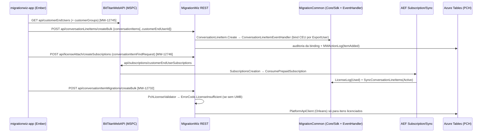

# Scaffold arquitetural do MigrationWiz + Feature 1 (PCH / UMB)

> [!info] Escopo e método
> - Varredura do `Master.sln` (**166 `.csproj`** referenciados) em `C:\$\Development`, mais o monorepo Ember em `C:\$\Front\FrontEnd`.
> - Branch analisado: `feature/MW-12732-pch-umb-licensing`, commit `a37f211b00` (02/11/2026), working tree limpo.
> - As contagens de arquivos são de `.cs` físicos, sem `bin/` e `obj/`.
> - Nada foi alterado no repositório e nada foi adicionado ao Git. Esta nota fica fora do repositório.
> - Glossário rápido:
>   - **PCH** = Teams Private Chat (project type `CollaborationChat`).
>   - **UMB** = User Migration Bundle (SKU 700002).
>   - **CEU** = CustomerEndUser, o usuário no MSPComplete.
>   - **Line item** = item do projeto: `Mailbox` nos projetos clássicos, `ConversationLineItem` no PCH.

---

## 1. Tabela explicativa: projetos do ecossistema MigrationWiz

### 1.1 Camada Web / API (porta de entrada)

| Projeto / Módulo | O que Trata / Responsabilidade | Arquitetura & Padrões | Comunicação & Dependências |
|---|---|---|---|
| **MigrationWiz** (628 .cs) | Backend REST `api/...` da SPA Ember do MW: projetos, line items (Mailbox e PCH), migrações, estimativas, licenças (`LicenseAttach`), hybrid, suporte e quotes. Algumas páginas MVC (Quote, Invoice). | ASP.NET MVC5 + Web API 2 + OWIN. **Dois estilos de API**: 1. **Manual** (a maior parte): `Controllers\Api\XxxController : ApiController` + `[RoutePrefix("api/xxx")]`, `Api\Services\IXxxService`/`XxxService(Ticket)`, `Api\DTOs\XxxDTO`, `Api\Requests\XxxFindRequest : AbstractFindRequest<Guid>`, `Api\Messages\Xxx{Single,List,Paginated}Message`. 2. **Gerado**: `RestApi\Controllers\Generated\*.Generated.cs : MigrationWizEntityController`. **Sem container de DI**: serviços criados em propriedades *lazy* com setter, que servem de *seam* para testes (`ProjectItemsController.cs:63-110`). Parâmetros opcionais no construtor fazem o mesmo papel (`ConversationItemMigrationsService(Ticket, MWActionLogService = null, IPlatformApiClient = null)`). Filtros globais em `App_Start\WebApiConfig.cs`: Authorize, LogRestCallDuration, GlobalApiExceptionFilter, Throttling. | ORM in-process via MigrationCommon (`DataAccessManager`, `ManagementEngine.Instance.Execute`). REST para a BitTitanWebAPI via `AuthenticatedRestApiClient` (subscriptions). REST para a **Platform API** (serviço externo em Orleans) via `Api\Services\Platform\PlatformApiClient` (PCH). Azure Tables para o PCH (`Api\Azure\Storage\*Entity`). Mailer. |
| **MigrationWizWebApp** (74) | UI legada WebForms e **hub SOAP** `API\1.0|2.0\WebService.asmx`. Atende engine, PowerShell/SDK e clientes antigos. | **Command**: um único `[WebMethod] Execute(Request)`. Cada `Request` faz `Validate()` e depois `ExecuteRequest()` (`Code\API\1.0\WebService.cs:62`). Contexto via SOAP Headers. `SafeExecution.ExecuteAndCheck<T>`. Páginas `BasePage`/`SecurePage`. | Chamado via MigrationProxy. Grava no SQL via MigrationCommon. |
| **MigrationWebCommon** (15) | Peças REST compartilhadas entre MW e BitTitanWebAPI: Hybrid CSV import e `ProjectSystemType`. | Interface de serviço + `Services\Impl`, DTOs, Requests, Messages. | Common, Core, MigrationCommon, WebApiCore. |
| **WebApiCore** (185) | Framework REST comum a todos os hosts Web API. | **Template Method**: `BaseController`, `EntityController<…>` (Get/Find/Patch/Delete/Count/GroupBy + sideloading), `EntityService<T>`. Middleware OWIN de autenticação (JWT, Ticket). Filtros em `Attributes\`, mais Swagger e Validation. | Base de MigrationWiz, BitTitanWebAPI e BitTitanInternalWebApp. |
| **BitTitanWebAPI** (377) | API da plataforma BitTitan / **MSPComplete** (`api.bittitan.com`): **CustomerEndUsers**, **CustomerGroups**, **Subscriptions (UMB)**, workgroups, offerings, device management. Também serve o SOAP `ManagementService.asmx`. | Controllers **gerados** pelo RestAPIGenerator (119 arquivos `*.Generated.cs`, `partial`), com *partials* manuais ao lado. Base `BitTitanWebApiEntityController`. Serviço instanciado no construtor (`new CustomerEndUserService(ticket)`). | In-process com MigrationCommon. Dispara workflows AEF (`WorkflowTypes.MpscSubscriptionsCreation`). Consumido pelo MW (LicenseAttach) e pela SPA (`mspc/*`). |
| **BitTitanWebApiCommon** (678) | Contratos da BitTitanWebAPI compartilhados com MW e clientes: DTOs, Requests (`CustomerEndUserFindRequest*`), Responses (`SubscriptionEstimateResponse`), Messages. | Contratos/DTO, *partials* separados por assunto. | Usado por BitTitanWebAPI, MigrationWiz e testes. |
| **BitTitanInternalWebApp** (251) | Portal interno (Support, Ops, Sales, Finance, Dev): **View/Edit Product SKU**, license packs, diagnósticos, impersonate, área AEF. | MVC5 + **Autofac**, o único host web com container. Composition root em `Global.asax.cs:246-277`; todo `IControllerService` é registrado por varredura de assembly. AutoMapper em `AutoMapperConfig`. | MigrationCommon in-process, Migration/ManagementProxy, AEF. |
| **PortalWebApp** (84) | Portal self-service do dono da mailbox: configuração de conector, pagamento, invoices. **Não é o MSPComplete.** | WebForms (`SecurePage : BasePage : CommonBasePage`), serviços pequenos em `Code\Services`. | MigrationCommon. |
| **Mailer** (39) | E-mails transacionais (MvcMailer + Razor): `UserMailer`, `SupportMailer`, `CrmMailer`, `GenericMailer`. | Pares `IXxxMailer`/`XxxMailer : BaseMailer`. | Usado por MigrationWiz, BitTitanWebAPI e Internal. |
| **WebAspCommon** | HttpModules (Error, Wsdl), páginas base e controles WebForms. | Biblioteca utilitária. | BitTitanWebAPI. |

### 1.2 Núcleo de domínio e plataforma

| Projeto / Módulo | O que Trata / Responsabilidade | Arquitetura & Padrões | Comunicação & Dependências |
|---|---|---|---|
| **MigrationCommon** (1738) | **Coração do domínio MW.** - Entidades persistidas em `Migration\Core`: `MailboxConnector` = projeto, `Mailbox` = line item clássico, `MailboxMigration`/`MailboxQueue` = execução, **`ConversationLineItem` = line item PCH**. - Objetos SDK em `Sdk\Api\1.0\Objects` e mensagens em `Sdk\Api\1.0\Messages\*Request`. - Também: conectores, `LicenseManager` (singleton), eventos e host WCF. | - **ORM próprio, database-first**, configurado por atributos (`[TableName]`, `[IdFieldName]`). Classes base `PersistedObject`/`DatedPersistedObject`. Fachada estática `Engine\DataAccessManager`. - **Request/Command**: `XxxRequest : BaseAuthenticatedRequest` com `Validate()` e `ExecuteRequest()`. - **Observer de entidade**: `[EventHandler(Create\|Update, …, typeof(XxxEventHandler))]` + `IEventHandler.BeforeExecute/AfterExecute` (ex.: `MailboxEventHandler`). - **Strategy + Factory + Template Method** nos conectores: descritores XML em `Resources\Descriptors\*.xml` (`<RequiredFeatures>`, `<ConnectorFactory>`) lidos por `DescriptorsBuilder`. - **Service Locator** Autofac estático (`Infrastructure\ServiceLocator.cs`) para os módulos Clean Architecture. | Referenciado por quase tudo. Agrega os módulos `*.Application`. Exposto por SOAP (MigrationWizWebApp) e in-process (MigrationWiz). |
| **Common** (1438) | Plataforma compartilhada: - ORM SendBus/Lookup (`Database\Objects`) e wrappers de API pública (`Access\Objects\{Core,Lookup,MigrationWiz}`). - `Access\Execution\ManagementEngine`. - **Financial/Licensing** (`FeatureGuid`, `ProductSkuGuid`, `ProductSkuUtils`, `LicensingEngine`, `SubscriptionEntitlementManager`). - Também: FeatureFlags, MWActionLog, EventHandler e contratos do AEF. | `EntityWrapper` com atributos `[PublicWsdl]`, `[MustBeSet]`, `[CannotUpdateProperty]`. Descoberta de event handlers por reflexão (`EventHandlerInvocationContext`). Constantes e enums centralizados. | Depende de Core, Caching, BTLog, CloudInfrastructure, ContainerService etc. É referenciado por todos. |
| **Core** (210) | Base sem dependências de projeto: atributos do ORM, `ResilientExecution` (Polly), Log, Concurrency, `ErrorCode`. | Factory de políticas Polly (`ResilientPoliciesFactory`). | Base de toda a solution. |
| **MigrationUniversal** | Modelo canônico "Universal" de itens (Data, Reader, Serialize, Convert). | Canonical Data Model / Adapter. | Core, BTLog. Usado por conectores. |
| **EmailClientCommon** (131) | SPI genérica de clients de e-mail (`IMigrationWizClient`) e **`Utils\MigrationWizToMspcSyncingService`**, a ponte entre line item e CEU/UMB (`RunSync`, `SyncMailboxes`). | Plugin/SPI. | Usado pelos conectores, pelas mensagens de subscription e pelo `MailboxEventHandler`. |
| **SharePointCommon** (133) | SharePoint/OneDrive (CSOM, Graph, MSAL). | Classes `Commands\*Command`, Services. | Conectores Document/OneDrive. |
| **PowerShellExtension** (89) | Sessões PowerShell EXO / AzureAD / Graph. | Template Method (`PowerShellBase`). | Conectores e AEF. |
| **Caching** (25) | Cache local + Redis (`DistributedCacheService`, `FastDistributedLock`). | **Interceptors** Castle DynamicProxy (`ResilientExecutionInterceptor`, `FeatureToggleInterceptor`, `PerformanceLoggingInterceptor`). | Serviços web e engine. |
| **BTLog / BTTelemetry** | Serilog estruturado (Elasticsearch/Kibana, Statsd) e Application Insights. | Sinks e enrichers. | Transversal. O PRD exige logs no Kibana. |
| **OemCommon / Estimator** | Integrações OEM; estimativa de duração e tamanho por workload. | Estimator usa Strategy (`IEstimator`, `*Workload`). | Common/Core; BitTitanWebAPI. |
| **Databases\MigrationWiz** (SSDT) | Schema SQL do MW (`Tables\Mailboxes.sql`, `ConversationLineItem.sql` …). | Fonte do schema *database-first*. | Base do ORM MigrationCommon. |
| **Deployment\{Prod,Germany}\LicensingData.xml** | Catálogo de Features, ProductSkus, ProductSkuFeatures e ProductRates. | Dados de configuração (importados pelo `DatabaseBootstrap`). | `LicensingEngine`; também editável pelo Internal ("View/Edit Product SKU"). |
| **ORMGenerator / RestAPIGenerator / CodeGenerator** | Geram entidades (YAML), controllers REST/DTOs (templates `.txt`) e cmdlets PowerShell. | Geração de código em build-time. | A saída é versionada em Common, BitTitanWebAPI e BitTitanPowerShell. |

### 1.3 Engine de migração e PCH

| Projeto / Módulo | O que Trata / Responsabilidade | Arquitetura & Padrões | Comunicação & Dependências |
|---|---|---|---|
| **MigrationWizEngine\MigrationService** | Host (Windows Service ou console) dos workers. | `ServiceBase`; config transforms por ambiente. | MigrationCommonClient, ContainerService. |
| **MigrationWizEngine\MigrationCommonClient** | Runtime do engine: Registrator, Pinger, Downloader, Processor, StatusUploader, zone schedulers (VMSS). | Workers `MigrationService<Role> : ThreadedTimerBase`. Factory de executores. | **Polling SOAP** (`RetrieveMailboxMigrationByServerId`) via MigrationProxy. Não há barramento entre web e engine. |
| **Microservices\TeamsChatMigrationService** | Microserviço (Docker) que importa chats do Teams no destino via Graph (caminho legado). | `Interfaces\I*Service` + `Services\*Service`, ligados com `Lazy<>`, sem container. | Azure Storage Queue (`teamschatimportqueue`) + Blob criptografado; SOAP; Graph. **Fora do escopo** (PRD 5.2.2). |
| **PCH "Next" (Platform API)** | A execução do PCH acontece num serviço externo (Orleans), acionado pelo MW REST. | `PlatformApiClient : IPlatformApiClient` (HttpClient estático lazy), rotas `/v1/migrations/TeamsChatMigration/{id}`, `VerifyTargetLicenseOnly`, `TeamsChatMigrationCleanup`. | Estado em Azure Tables (`ConversationLineItemTableEntity`, `LineItemQueueTableEntity`). |
| **MigrationServiceUtilities** | Toolbox dev/ops (ClientTools, CodeGeneration, `UmbUtilities`). | Factories, incluindo mocks. | Referencia todos os `*.Application`. |
| **Clients\*, ExtractorCommon, ClientLogger** | Agentes on-prem (Lotus, Vault, Hybrid), runtime de extractors, upload de logs. | Coordinator; Strategy + Factory (`ClientLogUploaderFactory` → AzureBlob/S3). | WCF (WCFProxy), SOAP, Blob/S3. |
| **MigrationProxy / ManagementProxy / WCFProxy** | Clients SOAP gerados (ASMX do MW e da BitTitanWebAPI) e cliente WCF. | **Proxy** gerado + partials (`SafeExecution`, `*.Authorization`). | Canal do engine, SDK, extractors e AEF. |
| **ContainerService / CloudInfrastructure / AzureCommon** | Docker/Swarm; Azure Service Bus (REST), AKS; resolução de nuvem (incluindo **Germany**). | Factory, Strategy; políticas resilientes. | Engine e AEF. |

### 1.4 Módulos Clean Architecture (workloads novos)

| Projeto / Módulo | O que Trata / Responsabilidade | Arquitetura & Padrões | Comunicação & Dependências |
|---|---|---|---|
| **MigrationWizEngine.GoogleSharedDrive / GoogleGroups / GoogleVault / M365Groups / M365SharedMailbox** (cada um com Domain, Application, Infrastructure, Consumer e testes) | Migração de Google Shared Drives, Google Groups, extração do Vault, M365 Groups e Shared Mailboxes. | **Clean Architecture** com domínio anêmico (`AggregatesModel`). - **Autofac `ApplicationModule`** com extensões `AsWithCommonInterceptors<I>()`. - **Interceptors** Castle de *guard* (`NullChecking`, `StringEmptyOrWhitespaceChecking`). - **Decorators** registrados via `RegisterDecorator`: Cache (`localMemory`/`redis`), Retry e Exception. - AutoMapper inline (sem `Profile`) e Polly. - **Sem MediatR e sem CQRS** (0 ocorrências). | In-process: os conectores do MigrationCommon resolvem por `ServiceLocator.GetService<T>(mailboxId)`. Registro em `ModuleContainerInitializer` via `*AppModuleBuilder.BuildModules()`. |

### 1.5 Orquestração assíncrona (AEF), SDK e testes

| Projeto / Módulo | O que Trata / Responsabilidade | Arquitetura & Padrões | Comunicação & Dependências |
|---|---|---|---|
| **AEFCommon / AEFCoordinationService / AEFExecutionService** | Runtime de workflows: coordenação (deciders, TimerWheel, providers recorrentes) e execução das activities. | **Workflow/Activity** sequencial: `[Workflow(WorkflowTypes.X)] XWorkflow : IWorkflow` monta `SequentialWorkflowModel.AddStep`; `[Activity(AefActivityName.Y)] YActivity.Execute(ctx)`. **Registro por reflexão** (`ActivityFactory`/`WorkflowFactory`, `Activator.CreateInstance`, por isso as activities exigem construtor sem parâmetros). | **Azure Service Bus** (PushScheduler) + SQL (`SchedulerDatabaseStorage`). |
| **AEFWorkflows** | Workflows de produto. **Subscription**: Creation, Processing, Revoke, ExpiredProcessing. **Synchronization**: `MailboxToCustomerEndUserActivity`, que repara bindings que falharam. Também Discovery, Hybrid, MspcTasks. | Pares Workflow + Activity. Bases: `SubscriptionBaseActivity` (chunk de 100, SOAP clients, `SafeNetworkExecute`) e `SynchronizationBaseActivity`. | SOAP (Management/MigrationWiz) e SQL. |
| **AEFInternalAutomationWorkflows / AEFAutomationWorkflows** | Automação interna: **AuditLicenseLog**, **AuditSubscriptionAbuse** (Sales), CRM, finanças. | Base `AbstractInternalAutomationActivity`, SQL cru e relatórios por e-mail. | SQL, e-mail. |
| **BitTitanPowerShell (SDK) / MigrationSupportPowerShell** | Módulo PowerShell público (`MW_*`, `BT_*`). É ele que faz o bulk edit de endereços via SDK. | Cmdlets gerados (`Cmdlets.Generated.cs`) + manuais. | SOAP via Migration/ManagementProxy. |
| **Testes** (UnitTestMigrationWiz 564, UnitTestCommonComponents 475, IntegrationTests 431, ApiTests 258, AEF Unit/Integration 103/85, IntegrationTestMigrationWiz 40, TestCommon 47, AutomatedUITests) | Unitários, integração, API REST/SOAP, AEF e UI. | **NUnit + Moq** (MSTest quase não é usado; Ranorex nos testes de UI). Unit tests espelham a árvore do código-fonte. `[Category("Namespace.Pontilhado")]`. Métodos `Metodo_GivenX_DoesY` no código novo. `TestCommon` é biblioteca de helpers (`TestHelper`, `MigrationWizOrmValidator`). | Projetos sob teste. |

### 1.6 Frontend (fora do `Master.sln`)

| Projeto / Módulo | O que Trata / Responsabilidade | Arquitetura & Padrões | Comunicação & Dependências |
|---|---|---|---|
| **Front\FrontEnd\migrationwiz-app** | SPA do MW: página do projeto (toolbar, grid, flyouts Add from MSPC, Apply UMB e Change Domains), Start Migration. | **Ember.js clássico**: - `app\components\<ns>\<nome>.js` + `app\templates\components\<ns>\<nome>.hbs`, com `PropTypesMixin`/`AssertUnknownPropertiesMixin`. - Tasks `ember-concurrency` (`_x: task(function*(){})`), services com `ajax` + `Util.buildApiHostUrl('migrationWiz')`. - A toolbar legada fica no partial `templates\project\-project-items-old.hbs`. - Testes ember-qunit + sinon (unit, integration, acceptance). | REST `api/...` do MigrationWiz e `api.bittitan.com` (adapters `mspc/*` herdados da bittitan-ember-lib). |
| **mspcomplete-app** | SPA do MSPComplete: People, apply/remove de subscription por usuário, Settings > Licenses. | Ember. | BitTitanWebAPI. |
| **store-app** | Loja (store.bittitan.com): card do produto 700002 e página de descrição do UMB. | Ember. | BitTitanWebAPI. |
| **bittitan-ember-lib / bittitan-i18n** | Models compartilhados (`project-system-type`, `mspc/customer-end-user`, `migrationwiz/project`) e traduções. | Addon Ember. Na i18n, o texto de dev fica em `en-PT` e é mesclado sob todos os locales. | Usados por todas as apps. |

> [!note] Fora do ecossistema MW (estão no `.sln`, mas não foram mapeados)
> Nautilus\* (benchmark), DeviceManagementServices\*, AutomationScriptRunner\*, DnsWonder, Zendesk, InternalAutomationTools\*, DevMetrics, LogViewer, CmdletDocumentation\*, UploadWiz/Coexistence (adjacentes) e utilitários de build.

---

## 2. Resumo: o que é o MigrationWiz e como está estruturado

**O que é.** O MigrationWiz (BitTitan, grupo Idera) é uma plataforma SaaS de migração para a nuvem. Ele move mailboxes, documentos (OneDrive/SharePoint/Google Drive), arquivos pessoais, Teams (canais e chats privados, o PCH), Google Groups/Shared Drives/Vault, M365 Groups e Shared Mailboxes entre tenants e plataformas.

É vendido por licenças:
- *per-item*;
- **User Migration Bundle (UMB, SKU 700002)**: licença por usuário, válida por 12 meses, que hoje cobre Mailbox, OneDrive/Documents, Archive etc.

As licenças são aplicadas a um **CustomerEndUser** no **MSPComplete** e vendidas na **BitTitan Store**. O PCH ainda roda sem licença; o PRD deste épico leva o PCH para o modelo UMB.

**Como está estruturado:**
- **Monólito em camadas, .NET Framework 4.8**: csproj no formato antigo, dependências via **paket**, build pelo `Master.sln` no Azure Pipelines. O frontend Ember fica em outro repositório.
- **Web:**
  - `MigrationWiz` serve a REST da SPA.
  - `MigrationWizWebApp` serve WebForms e o hub **SOAP** `Execute(Request)`.
  - `BitTitanWebAPI` serve a REST do MSPComplete e da Store.
- **Domínio:**
  - `MigrationCommon` (domínio MW + ORM *database-first* sobre o schema SSDT) fica sobre `Common` (ORM Lookup/SendBus, Licensing/Financial, constantes) e sobre `Core`.
  - Toda lógica de negócio recebe um **`Ticket`** (contexto de segurança).
  - O acesso a dados passa por `DataAccessManager` / `ManagementEngine` / `Entity.Create(ticket)`.
- **Engine:** workers *pull-based* que fazem polling SOAP. O PCH é diferente: roda na **Platform API (Orleans)**, com estado em **Azure Tables**.
- **Assíncrono:** o **AEF** (Service Bus + SQL) orquestra subscriptions/UMB, sincronização com o MSPComplete e auditorias.
- **Workloads novos:** módulos *Clean Architecture* isolados (Autofac, Decorators, Castle interceptors), alcançados por um `ServiceLocator` estático.
- **Licenciamento UMB hoje:**
  1. O line item `Mailbox` tem `CustomerEndUserId`, `MspcSynchronizationDate` e `SyncSubscriptionStatus`, preenchidos pelo `MailboxEventHandler` → `MigrationWizToMspcSyncingService.RunSync`.
  2. A elegibilidade sai da combinação `<RequiredFeatures>` do descritor × `ProductSkuFeature` (LicensingData.xml) × `SubscriptionEntitlementManager`.
  3. O consumo é registrado em `LicenseLog`.
  4. O bloqueio na submissão acontece em `Sdk\...\Objects\MailboxMigration.cs:811-853` (`ErrorCode.LicenseInsufficient`).

**O que NÃO existe:** MediatR, CQRS, EF Core, Repository/UoW genéricos e container de DI no MigrationWiz REST. Não proponha esses padrões; siga o estilo que já existe.

---

## 3. Padrões de codificação identificados (base para futuras skills)

| Tema | Padrão observado | Evidência |
|---|---|---|
| Endpoint REST (MW) | `[RoutePrefix("api/camelCasePlural")]`. Rotas bulk em verbo minúsculo (`createBulk`, `deleteBulk`, `find` via POST). `Ticket` montado de `User.Identity.Name`. O DTO se valida com `Validate(ModelState)` chamado à mão. Respostas `XxxSingleMessage`/`PaginatedMessage`. | `ProjectItemsController.cs:115-160`, `ConversationItemsController.cs:22,157` |
| Serviço | `IXxxService` + `XxxService(Ticket, deps opcionais = null)`. Dependências "lazy" via `?? new`. Bases `AbstractApiService<T>`/`AbstractPaginatedApiService<T,TFind>`. | `ConversationItemMigrationsService.cs:58-68` |
| DTO ↔ entidade | Mapeamento manual: construtor `new XxxDTO(entity)` e método `GenerateXxx(Ticket)`. Nada de AutoMapper na API MW. | `ProjectItemDTO.cs:259,396`; `ConversationLineItemDTO.GenerateConversationLineItem` |
| FindRequest | `XxxFindRequest : AbstractFindRequest<Guid>, IValidatableObject` com `GenerateRetrieveRequest(Ticket)`. | `ProjectItemFindRequest.cs:77` |
| Transação | `TransactionScope` com `IsolationLevel.RepeatableRead` em createBulk. | `ConversationLineItemsService.cs:158-162` |
| Erros | `Errors.Assert*`, `ExecutionException(ErrorCode.X)`. No controller: `HttpResponseException(Request.CreateErrorResponse(...))`, mapeando `ErrorCode` para status HTTP. | `ProjectItemsController.cs:139-160`, `Core\Api\ErrorCode.cs` |
| Log e auditoria | `exception.LogError("template {a}", …)` (Serilog estruturado). Action log via `MWActionLogService.ShouldLogMWActions()` → `LogActionForItems(items, MWActionOnItems.X)`. | `ConversationLineItemsService.cs:166-175` |
| SDK / SOAP | `XxxRequest : BaseAuthenticatedRequest` → `Validate()` + `ExecuteRequest()`. Privilégio verificado no request. | `ConsumePrepaidSubscriptionRequest.cs:79` |
| Reação a mudança de entidade | `[EventHandler(...)]` na entidade Core + `IEventHandler.BeforeExecute`. Reparo assíncrono por uma Activity AEF. | `Mailbox.cs:20`, `MailboxEventHandler.cs`, `MailboxToCustomerEndUserActivity.cs` |
| Nova coluna em entidade MW | Passa por 5 camadas: `Databases\...\Tables\*.sql` → `MigrationCommon\Migration\Core\*.cs` → `MigrationCommon\Sdk\Api\1.0\Objects\*.cs` → `Common\Access\Objects\MigrationWiz\*.cs` → `MigrationWiz\Api\DTOs\*DTO.cs` (+ model e serializer Ember). | Mailbox: `Mailboxes.sql:3,34,35` … `ProjectItemDTO` |
| Código gerado | `*.Generated.cs` é `partial`: estenda no arquivo irmão manual e nunca edite o gerado. | BitTitanWebAPI, BitTitanPowerShell |
| Documentação no código | `/// 
` em todo membro e comentários de passo (`// Prepare…`, `// Create…`). | Todo o MW |
| Testes C# | NUnit `[TestFixture]`/`[Test]`/`[TestCase]`, Moq. Subclasse `XxxTestable` para trocar serviços. `[Category("A.B.C")]`. | `ProjectItemsControllerUnitTests.cs:173` |
| Componente Ember | `Ember.Component.extend(PropTypesMixin, AssertUnknownPropertiesMixin, { propTypes, tagName:'' })`, `Ember.inject.service`, YUIDoc, prefixo `_` em privados, `task(function*)`. | `components\project\add-items-mspc.js` |
| Chamada bulk Ember | `ajax.request(Util.buildApiHostUrl('migrationWiz') + '/api/xxx/createBulk', { method:'POST', data: JSON.stringify({ root: [...] }) })` em lotes de 100 (`Util.partitionPromise`). Depois `storeEventsService.trigger('didCreateRecord.<model>')`. | `add-items-mspc.js`, `bulk-add-item.js:1867-1886` |
| i18n | Texto de dev em `bittitan-i18n\translations\<app>\en-PT\EmberAppTranslations.json`. Os demais locales vêm do CrowdIn. | `broccoli-i18n-files.js:23,197-225` |
| Testes Ember | `moduleForComponent`/`moduleForModel`, sinon, mocks do `bittitan-ember-testing` (`mockModel`, `stubResolvesWith`, `i18nMock`). | `tests\unit\components\project\add-items-mspc-test.js` |

---

## 4. Dicas para o Claude Code trabalhar melhor neste repositório

1. **Crie um `CLAUDE.md`** na raiz de `Development` (hoje não existe) com: .NET 4.8 + paket, "sem DI no MigrationWiz REST", os dois ORMs, o `Ticket` obrigatório, e a regra *PCH = `ConversationLineItem`, nunca `Mailbox`*. Aponte para `Documentation\` e para a seção 3 desta nota.
2. **Sempre procure o "irmão" Mailbox/OneDrive antes de criar algo.** O PRD e os tickets exigem reuso. Primeiro faça grep pelo nome Mailbox (`ProjectItem*`, `MailboxSummary`, `SyncMailboxes`, `CustomerEndUserId`), depois pelo equivalente PCH (`ConversationLineItem*`, `ConversationItem*`, `isTeamsPCH`, `isCollaborationChat`).
3. **Trabalhe por projeto, não pela solution.** São 166 projetos. Use subagentes Explore com escopo de pasta e prefira `msbuild <Projeto>.csproj` a buildar tudo.
4. **Não edite `*.Generated.cs`.** Altere o template/fonte do gerador ou a *partial* manual.
5. **Peça checklists por camada** para qualquer coluna nova (ver seção 3, "Nova coluna").
6. **Feature flags** (`Common\FeatureFlags\FeatureToggleNames.cs`): o PRD 4.5 diz que o enforcement vale só para projetos PCH **novos**. Gate tudo.
7. **Logs:** use Serilog estruturado + `MWActionLogService`. O PRD exige motivo do bloqueio e métricas de consumo visíveis no Kibana.
8. **Segurança (PRD 7.10 / Apêndice A):** não cole `Web.config`/`app.config`, connection strings, tokens nem dados de clientes nos prompts. Todo output de IA precisa de revisão humana. Nunca envie nenhuma informação sensível aos servidores do claude.
9. **Para o frontend**, rode os testes do app afetado (`ember test --filter "<módulo>"`) e lembre que a toolbar dos projetos não-Teams fica em `-project-items-old.hbs`.
10. **Para skills futuras**, os candidatos naturais são: "novo endpoint REST MW", "nova coluna em entidade MW (5 camadas)", "novo Request SDK", "nova Activity AEF", "novo componente Ember com task" e "estender feature Mailbox para PCH".

---

## 5. SCAFFOLD DA FEATURE 1: UMB License Enablement para Teams Private Chat

> [!abstract] Tickets cobertos (PRD 5.3)
> - **MW-12732**: épico funcional / backend core.
> - **MW-12745**: Add from MSPComplete *(seu ticket)*.
> - **MW-12746**: Apply/Remove License + coluna UMB.
> - **MW-12747**: Store e marketing.
> - Relacionado: **MW-12099** (LicensingData.xml / SKU).
>
> *Dependência:* Change Domain e SDK bulk são da **Feature 2** (MW-11330/12737/12738), mas o MW-12732 exige que a binding sobreviva a essas mudanças. Por isso aparecem aqui como "pontos de contrato".

### 5.0 Diagnóstico: o estado atual do código

| # | Lacuna | Evidência | Consequência |
|---|---|---|---|
| D1 | A feature PCH **não existe** no catálogo | `FeatureGuid.CollaborationChat = 80941263-…` (`Common\Financial\Licensing\FeatureGuid.cs:129`) é exigida em `CollaborationChatDescriptors.xml:42-44,74-76`, mas tem **0 ocorrências** em `Deployment\Prod\LicensingData.xml` e em `Deployment\Germany\LicensingData.xml`. O UMB (700002, `39854d8c-…`) só tem a feature "MSPC End User Subscription". | `GetEligibleProductSkuIds` devolve vazio, e o UMB nunca cobre PCH |
| D2 | `SubscriptionEntitlementManager` não lista PCH | `ProductSkuIncludedEndUserPremiumSubscriptionHashSet` (`:18-47`) não contém nenhum SKU Collaboration | `IsProductIncludedInEndUserSubscription` = false |
| D3 | O line item PCH não tem binding com CEU | `Databases\MigrationWiz\Tables\ConversationLineItem.sql` e `Migration\Core\ConversationLineItem.cs` não têm `CustomerEndUserId`, `MspcSynchronizationDate` nem `SyncSubscriptionStatus`, e não há `[EventHandler]`. Só o wrapper `Common\Access\Objects\MigrationWiz\ConversationLineItem.cs:41` tem `CustomerEndUserId` (órfão). O `ConversationLineItemDTO` também não tem. | Não há onde guardar a licença nem o status "UMB Active" |
| D4 | A submissão PCH não checa licença | `ConversationItemMigrationsService.CreateBulk` (`:107`) chama `PlatformApiClient` direto (`:132/137/142`) | Não bloqueia Verify, Pre-Stage nem Full |
| D5 | A estimativa PCH vem zerada | `ConversationItemMigrationsService.cs:306/314/328`: `TotalLicensesAvailable = 0`, `RequiredLicenseCount(0,0)`, chamadas reais comentadas | A UI nunca acusa falta de licença |
| D6 | Apply/Revoke só para Mailbox | `LicenseAttachService` (`:71/118/207`) recebe `ProjectItemSubscriptionRequest` e resolve CEUs só por `MailboxSummary` (`:336`) | `api/licenseAttach/*` ignora PCH |
| D7 | Consume, Revoke e Expire só sincronizam Mailbox | `ConsumePrepaidSubscriptionRequest.cs:249,564` e `RevokeSubscriptionRequest.cs:235` chamam `SyncMailboxes`. `SyncExpiredSubscriptionsRequest.cs:137`. `RevokeSubscriptionRequest.ValidateAssociatedEntities` (`:270-305`) só olha o histórico de Mailbox. | O status UMB do PCH nunca é atualizado, e a revogação não enxerga job PCH |
| D8 | A janela de revogação não é aplicada | `RevokeSubscriptionRequest.cs:30` declara `HOURS_AFTER_SUBSCRIPTION_CREATION_TRESHOLD = 48` e **nunca usa** | A regra de 24h do ticket exige lógica nova (valor a confirmar) |
| D9 | A UI desliga o PCH explicitamente | `models\project.js:917` (`!isTeamsPCH` em `supportsAddFromMspc`); `controllers\project\project-items.js:28` (`shouldHideApplyLicenses`); `-project-items-old.hbs:226-248, 983-993, 1120-1167` (`isCollaborationChat`); `start-migration.js:900` (`_canUseUmb`); `projects-properties.js:416` (Change Domains) | Toolbar sem Add from MSPC, Apply e Remove; sem filtro/coluna UMB |
| D10 | O model Ember do PCH não tem CEU | `models\conversation-line-item.js` não tem `customerEndUser` nem `syncSubscriptionStatus` (o `project-item.js` tem, em `:468/:1160`) | Add from MSPC e coluna UMB não funcionam para PCH |

### 5.1 Fluxo alvo

### 5.2 NOVOS arquivos a criar

> **Convenção:** espelhe nomes e pastas dos equivalentes Mailbox. Não há MediatR/CQRS. A lógica fica em *Services* (MigrationWiz), *Requests*/*EventHandlers* SDK (MigrationCommon) e *Activities* (AEF).

| # | Novo arquivo (proposto) | Projeto / Pasta | Papel | Ticket | Espelha |
|---|---|---|---|---|---|
| N1 | `IPchLicenseValidator.cs` + `PchLicenseValidator.cs` | `MigrationWiz\Api\Services\` (ou subpasta `Licensing\`) | Para cada `ConversationLineItem`: (a) o connector é isento? (b) o CEU tem UMB ativo? Devolve os itens bloqueados + motivo. Usado em `CreateBulk` e `GetEstimate`. Respeita o flag "projetos novos". | 12732 | `MailboxMigration.cs:811-853` + `LicenseManager.GetMailboxesExemptFromLicensing` (`:360`) |
| N2 | `ConversationItemSubscriptionRequest.cs` | `MigrationWiz\Api\Requests\` | Request de Apply, Revoke e Count baseado em `ConversationItemFindRequest` (ids, `idNotList`, filtros, `syncSubscriptionStatusIds`) | 12746 | `ProjectItemSubscriptionRequest.cs` |
| N3 | `ConversationLineItemEventHandler.cs` | `MigrationCommon\Sdk\Api\1.0\Events\` | `BeforeExecute` em Create/Update: chama `MigrationWizToMspcSyncingService.RunSync` com `ExportUser`/`ImportUserPrincipalName` e grava CEU, `MspcSynchronizationDate` e `SyncSubscriptionStatus`. Retorna cedo se já sincronizado e o prefixo UPN não mudou. | 12732 / 12745 | `MailboxEventHandler.cs:51-107` |
| N4 | `ConversationLineItemToCustomerEndUserActivity.cs` | `AsyncExecutionFramework\AEFWorkflows\Synchronization\Activity\` (+ registro no workflow de Synchronization) | Reparo assíncrono de bindings que falharam e **provisionamento retroativo** de UMBs aplicadas antes do gating (PRD 4.5) | 12732 | `MailboxToCustomerEndUserActivity.cs` |
| N5 | `PchLicenseBindingTableEntity.cs` | `MigrationWiz\Api\Azure\Storage\` | Registro de auditoria da binding: PK=ConnectorId, RK=LineItemId; CEU, SubscriptionId, SourceAddress, Action, AppliedAt, FirstJobSubmittedAt. Atende PRD 5.6 e o ticket ("Azure Storage Tables **e** DB"). | 12732 / 12746 | `ConversationLineItemTableEntity`, `LineItemQueueTableEntity` |
| N6 | `IPchLicenseBindingStorageService.cs` + `PchLicenseBindingStorageService.cs` | `MigrationWiz\Api\Services\` | Leitura e escrita de N5 com credenciais por zona | 12732 | helpers Azure de `ConversationLineItemsService.cs:838-908` |
| N7 | Script SQL: `ALTER TABLE ConversationLineItem ADD CustomerEndUserId, MspcSynchronizationDate, SyncSubscriptionStatus` + índices | `Databases\MigrationWiz\Tables\ConversationLineItem.sql` (+ script de upgrade conforme o padrão do sqlproj) | Persistência da binding | 12732 | `Mailboxes.sql:3,34,35,63,72` |
| N8 | `SyncConversationLineItems(...)` (método novo, não arquivo) | `EmailClientCommon\Utils\MigrationWizToMspcSyncingService.cs` | Atualiza `SyncSubscriptionStatus` dos line items PCH de um CEU | 12732 / 12746 | `SyncMailboxes` (`:219-261`) |
| N9 | Novos valores de `MWActionOnItems`/event type: `UmbLicenseApplied`, `UmbLicenseRevoked`, `MigrationBlockedNoLicense` | `Common\MWActionLog\` | Auditoria e Kibana (motivo do bloqueio e consumo) | 12732 / 12746 | `MWActionOnItems.ItemAdded` |
| N10 | Testes C#: `PchLicenseValidatorTests`, `ConversationLineItemEventHandlerTests`, `ConversationItemMigrationsServiceTests` (licença), `LicenseAttachServiceTests` (PCH), `ConversationLineItemToCustomerEndUserActivityTests` | `UnitTestMigrationWiz\MigrationWiz\Api\Services\`, `UnitTestMigrationWiz\MigrationCommon\Sdk\...`, `AEFUnitTests\` | Cenários positivos e negativos: sem licença, 24h, job já submetido, retry sem consumo extra, mesmo CEU em vários projetos (MW-12052/11977/11711) | todos | — |
| N11 | Testes de API: `ConversationLicenseAttachTest.cs`, `PchMigrationEstimatesTest.cs` | `ApiTests\RestApi\MigrationWiz\` | E2E REST | 12746 / 12732 | `LicenseAttachTest.cs` |
| N12 | Frontend: `ConversationLineItemValidator` (dentro do componente ou em `app\validators\`) | `migrationwiz-app\app\components\project\add-items-mspc.js` | Validação de `exportUser`/`importUserPrincipalName` (EMAIL) + `customerEndUser` | **12745** | `ProjectItemValidator` (`add-items-mspc.js:21-51`) |
| N13 | Store: bullet + tooltip "Teams Private Chat" e aba de cenário PCH | `store-app\app\templates\components\index\product-card-700002.hbs`, `...\index\product-description\user-migration-bundle.hbs` | Workload visível na loja | 12747 | bullets Mailbox/Documents |

### 5.3 Arquivos EXISTENTES a alterar: backend

| Projeto | Arquivo | Alteração | Ticket |
|---|---|---|---|
| **Deployment** | `Deployment\Prod\LicensingData.xml` **e** `Deployment\Germany\LicensingData.xml` (branches master **e** develop) | Adicionar `<Feature>` CollaborationChat `80941263-…` e `<ProductSkuFeature>` ligando o UMB 700002 (e variantes UMB, se houver) a ela | 12099 / 12732 |
| **Common** | `Financial\Subscriptions\SubscriptionEntitlementManager.cs:18-47` | Garantir que o SKU que cobre PCH está no hash set. Alternativa: atalho em `LicenseManager.GetEligibleProductSkuIds` como o T2T (`:739`). **Decisão de HLD.** | 12732 |
| **Common** | `Access\Objects\MigrationWiz\ConversationLineItem.cs` | Adicionar `SyncSubscriptionStatus` e `MspcSynchronizationDate` (o CEU já existe) | 12732 |
| **Common** | `FeatureFlags\FeatureToggleNames.cs` | Flag de enforcement PCH-UMB (só projetos novos, PRD 4.5) | 12732 |
| **Common** | `MWActionLog\*` | Novos tipos (N9) | 12732 |
| **MigrationCommon** | `Migration\Core\ConversationLineItem.cs` | Três propriedades novas + `[EventHandler(Create\|Update, MspcSynchronization, typeof(ConversationLineItemEventHandler))]` | 12732 |
| **MigrationCommon** | `Sdk\Api\1.0\Objects\ConversationLineItem.cs` | Expor CEU/status no SDK. Validar que o CEU existe. **Preservar CEU e `MspcSynchronizationDate` no update quando vierem vazios** (como `Sdk\Objects\Mailbox.cs:696-701`). Isso é o que mantém a binding em Change Domain e no SDK bulk. | 12732 (contrato F2) |
| **MigrationCommon** | `Migration\Core\LicenseManager.cs` (`:339`, `:360`, `:732`) | Versão de `GetMailboxesExemptFromLicensing` para line items (pares lineItemId/CEU) | 12732 |
| **MigrationCommon** | `Sdk\Api\1.0\Messages\ConsumePrepaidSubscriptionRequest.cs` (`:249`, `:564`) | Depois do consumo, chamar também `SyncConversationLineItems(Active)`. **Manter** `FilterAndFixAlreadyProcessedSubscriptions`/`DeleteInvalidSubscriptions` (1 UMB por CEU). | 12732 |
| **MigrationCommon** | `Sdk\Api\1.0\Messages\RevokeSubscriptionRequest.cs` (`:30`, `:235`, `:270-305`) | Aplicar a janela (24h × constante de 48h, confirmar com PM). Em `ValidateAssociatedEntities`, bloquear se houver job PCH (Azure `LineItemQueue` / `ConversationLineItem.Status` ≠ NotSubmitted). `SyncConversationLineItems(None)`. | 12746 |
| **MigrationCommon** | `Sdk\Api\1.0\Messages\SyncExpiredSubscriptionsRequest.cs` (`:98-138`) | Incluir PCH na expiração | 12732 |
| **EmailClientCommon** | `Utils\MigrationWizToMspcSyncingService.cs` (`:116`, `:219`) | Método N8. `RunSync` aceitando a identidade do line item PCH. | 12732 / 12745 |
| **MigrationWiz** | `Api\DTOs\ConversationLineItemDTO.cs` | `CustomerEndUserId`, `SyncSubscriptionStatus` (+ mapeamento no construtor e em `GenerateConversationLineItem`) | **12745** / 12746 |
| **MigrationWiz** | `Api\Services\ConversationLineItemsService.cs` (`CreateBulk :152`, `LogActionForItems :539`) | Persistir o `CustomerEndUserId` recebido. Registrar a auditoria (MWActionLog já existe + tabela N5). | **12745** |
| **MigrationWiz** | `Controllers\Api\ConversationItemsController.cs` (`CreateBulk :157`) | Aceitar o campo novo e validar (CEU pertence à organização do projeto) | **12745** |
| **MigrationWiz** | `Api\Requests\ConversationItemFindRequest.cs` | Filtro `syncSubscriptionStatusIds` (filtro UMB do grid) | 12746 |
| **MigrationWiz** | `Api\Services\LicenseAttachService.cs` (`:71`, `:118`, `:207`, `:336`) | Ramo PCH (N2) em Create, Revoke e Count, resolvendo CEUs por `ConversationLineItem.CustomerEndUserId` | 12746 |
| **MigrationWiz** | `Controllers\Api\LicenseAttachController.cs` (`:45`, `:69`, `:93`) | Aceitar o request PCH (rotas novas ou discriminador) | 12746 |
| **MigrationWiz** | `Api\Services\ConversationItemMigrationsService.cs` (`CreateBulk :107`, `GetEstimate :296-337`) | Chamar N1 antes do `PlatformApiClient`. Lançar `ErrorCode.LicenseInsufficient` com mensagem acionável + log. Calcular uma estimativa real (modelo: `ProjectItemMigrationsService`). | 12732 |
| **MigrationWiz** | `Controllers\Api\ConversationItemMigrationsController.cs`, `PchMigrationEstimatesController.cs` | Propagar erro e campos | 12732 |
| **MigrationWiz** | `Api\DTOs\ProjectDTO.cs` | `IsCustomerEndUserSubscriptionApplicable = true` para PCH elegível (é o que liga a coluna UMB na UI) | 12746 |
| **BitTitanWebAPI** | `RestApi\Services\SubscriptionService.cs` | Validar que estimate, subscribable e revoke contam CEUs de PCH sem duplicar por projeto. Não tocar em `*.Generated.cs`. | 12746 |
| **AEFWorkflows** | `Subscription\Activity\*` + registro de N4 em `Synchronization` | PCH em Processing, Revoke e ExpiredProcessing | 12732 |
| **AEFInternalAutomationWorkflows** | `Sales\Activity\AuditLicenseLogActivity.cs`, `AuditSubscriptionAbuseActivity.cs` | Considerar `ConversationLineItem` | 12732 |
| **BitTitanInternalWebApp** | *(sem código)* | Associar via "View/Edit Product SKU" e validar em Germany e Prod | 12099 |
| **TestCommon** | `TestHelper.cs` | Helpers de `ConversationLineItem` + CEU + subscription | testes |

> [!warning] "Registro" e Injeção de Dependência
> - O **MigrationWiz REST não tem container**. Para "registrar" N1 e N6, instancie-os na propriedade lazy ou no parâmetro opcional do serviço consumidor: `ConversationItemMigrationsService(Ticket, …, IPchLicenseValidator v = null) { this.PchLicenseValidator = v ?? new PchLicenseValidator(ticket); }`.
> - O **event handler** (N3) se registra pelo atributo `[EventHandler]` na entidade Core.
> - A **Activity AEF** (N4) é descoberta por reflexão via `[Activity(AefActivityName.X)]`, mas precisa entrar como *step* no workflow de Synchronization e ter construtor sem parâmetros.
> - **Não introduza Autofac nem MediatR** no MigrationWiz.

### 5.4 Arquivos EXISTENTES a alterar: frontend

| App | Arquivo | Alteração | Ticket |
|---|---|---|---|
| migrationwiz-app | `app\models\project.js:904-923` | `supportsAddFromMspc`: remover `!isTeamsPCH` (`:917`). Os descritores PCH já usam `IdentifierRequirements=EmailAddress`, então `emailAddressSupported` deve passar; confirmar em runtime. | **12745** |
| migrationwiz-app | `app\components\project\add-items-mspc.js` + `.hbs` | Ramo PCH em `_createProjectItemsAndValidate` e `_createBulkProjectItems`: `createRecord('conversation-line-item', {project, projectId, customerEndUser, exportUser: displayEmailAddress, importUserPrincipalName: displayEmailAddress})`. POST `/api/conversationLineItems/createBulk` com root `conversationItems` (padrão de `bulk-add-item.js:1867-1886`, lotes de 100). Trigger `didCreateRecord.conversation-line-item`. Avaliar o filtro "somente licenciados" pedido pelo ticket (`hasActiveSubscription`), que **não existe hoje**. | **12745** |
| migrationwiz-app | `app\models\conversation-line-item.js`, `app\serializers\conversation-line-item.js` | `customerEndUser: belongsTo('mspc/customer-end-user')`, `syncSubscriptionStatus: belongsTo('subscription-status')`. Serializar como `customerEndUserId`. | **12745** / 12746 |
| migrationwiz-app | `app\controllers\project\project-items.js:22-34` | `shouldHideApplyLicenses` passa a permitir PCH. Corrigir também as *dependent keys* (falta `type.isCollaborationChat`). | 12746 |
| migrationwiz-app | `app\templates\project\-project-items-old.hbs` (`:226-248`, `:711-746`, `:983-993`, `:1120-1167`, `:1359-1361`, `:1441-1455`) | Liberar Apply UMB, Remove, sort e filtro UMB para PCH. Coluna "User Migration Bundle Active" com "No" explícito. | 12746 |
| migrationwiz-app | `app\components\project\attach-umb.js` (`_projectItemFindRequest ~:205-266`) + `.hbs` | Montar o find request de conversation items quando for PCH | 12746 |
| migrationwiz-app | `app\components\actions\project-items.js:596-636` (`_removeLicense`) | Ramo `isTeamsPCH` com `ConversationLineItemIds` (como em `:386-410`) | 12746 |
| migrationwiz-app | `app\services\project-item-billing.js` (`:42`, `:74`, `:108`) | Enviar o request PCH para `/api/licenseAttach/*` | 12746 |
| migrationwiz-app | `app\components\project\start-migration.js` (`:778`, `:803-851`, `:900`, `:961`) + `.hbs` (`:247-255`, `:335`, `:415`) | `_canUseUmb` liberado para PCH. Estimativa PCH com licenças. Mapear o erro do backend para mensagem acionável. | 12732 |
| migrationwiz-app | `app\components\properties\projects-properties.js:416` + `modals\change-domains.js:197-206` | Change Domains para PCH (endpoint PCH) | contrato F2 (12737) |
| bittitan-i18n | `translations\migrationwiz-app\en-PT\EmberAppTranslations.json` (`addUsersMspc.*` `:126-128`, `project.itemHasActiveSubscription` `:2093`) | Textos PCH de flyout, bloqueio e tooltips | 12745 / 12746 / 12732 |
| bittitan-i18n | `translations\store-app\en-PT\EmberAppTranslations.json:209-226` | Copy PCH sob o UMB (persistência por prefixo UPN, sem transferência após 24h ou início de job) | 12747 |
| store-app | `product-card-700002.hbs:16-40`, `user-migration-bundle.hbs:2-21` | N13 | 12747 |
| testes FE | `tests\unit\models\project-test.js:652-744`, `tests\unit\components\project\add-items-mspc-test.js`, `tests\integration\components\project\add-items-mspc-test.js`, `attach-umb-test.js`, `tests\unit\models\conversation-line-item-test.js`, `tests\unit\serializers\conversation-line-item-test.js`, `tests\acceptance\licensing-project-items-test.js` | Casos PCH | todos |

> [!todo] Fora do código-fonte
> Página de pricing/marketing (time de marketing), Confluence, **HLD antes de implementar** (PRD 5.6), validação de SKU em Germany e Prod, demo gravada, relatório de handoff MW-13928.

### 5.5 Riscos técnicos identificados no código

1. **Dupla contagem entre projetos (MW-12052/11977/11711).** A proteção atual é "1 UMB por CEU". O PCH **precisa reutilizar o mesmo CEU** do Mailbox/OneDrive (binding por endereço de origem via `RunSync`), não criar CEUs novos.
2. **Binding × Change Domain.** A preservação depende de restaurar `MspcSynchronizationDate` no update do SDK e do *early return* do event handler. Se faltar qualquer um dos dois, uma troca de domínio re-sincroniza e pode trocar de CEU.
3. **O caminho de criação do PCH usa a entidade Core direto.** `ConversationLineItemsService.CreateBulk` chama `GenerateConversationLineItem` → `conversationLineItem.Create(ticket)`, sem passar pelo objeto SDK. O event handler precisa estar no **Core** para disparar nos dois caminhos.
4. **"Job submetido" no PCH fica no Azure** (`LineItemQueue`), não em `MailboxQueue`. A revogação precisa consultar Azure Tables com credenciais por zona.
5. **Pre-Stage no PCH** não tem chamada própria no `PlatformApiClient` (`ScheduleMigrationAsync(id, chatHistory, syncMigration)`). Confirmar como identificar Pre-Stage × Full para o bloqueio.
6. **Só projetos novos (PRD 4.5).** Use feature flag e/ou data de criação do connector para não bloquear projetos PCH antigos.
7. **24h × 48h.** Divergência entre requisito e constante não usada; confirmar com PM/Arquiteto.

Impacto detalhado por módulo e rastreabilidade requisito → arquivo: [[Scaffold_MW_revisado]].
